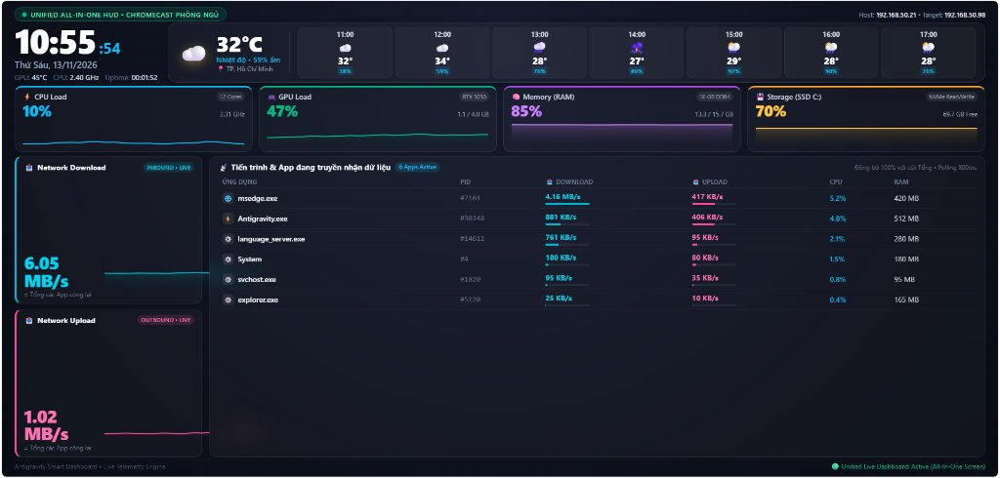

# 🖥️ Chromecast PC Telemetry HUD (All-In-One Dashboard)

<div align="center">

[](https://python.org)
[](#)
[](#)
[](#)

*Turn any Google Chromecast, Android TV, or secondary display into an ultra-sleek, real-time PC Hardware & System Telemetry HUD.*

<br/>



</div>

---

## 🌐 Language Navigation / Điều hướng ngôn ngữ
- [English Documentation](#-english-documentation)
- [Hướng dẫn Tiếng Việt](#-hướng-dẫn-tiếng-việt)

---

# 🇬🇧 English Documentation

## 🌟 Overview
**Chromecast PC Telemetry HUD** is a lightweight, real-time hardware monitoring dashboard designed to be cast directly onto your TV or smart display via Google Chromecast (using DashCast protocol) or accessed through any web browser on your local network.

Featuring a futuristic cyber-dark aesthetic, it continuously monitors your PC's hardware health, network traffic, system processes, and local weather forecasts with ultra-low latency.

## ✨ Key Features
- **⚡ Real-Time Hardware Waveform Charts:**
  - **CPU:** Real-time load percentage, operating frequency (GHz), and active core count.
  - **GPU:** NVIDIA GPU temperature, utilization %, and VRAM usage via `nvidia-smi`.
  - **Memory (RAM):** Accurate utilized vs total memory, percentage bar with hardware reservation awareness.
  - **Storage:** Primary disk usage % and remaining free storage.
- **📊 Top 10 Running Applications & Processes:**
  - Intelligently groups multi-process apps (e.g., `msedge.exe (39 tabs)`, `Antigravity.exe (10)`) to display true cumulative memory usage.
  - Dynamic bandwidth allocation tracking (Download / Upload speed per app).
- **🌐 Network Bandwidth Monitors:**
  - Live Download and Upload graphs synchronized with real-time throughput rates.
- **🕒 Clock & Weather Forecast:**
  - Real-time digital clock, system uptime, and Vietnamese day/date formatting.
  - 7-hour hourly weather forecast, temperature, humidity, and precipitation probability powered by Open-Meteo API.
- **📡 Seamless Chromecast Streaming:**
  - Built-in DashCast receiver integration (`serve_and_cast.py`) that auto-discovers Chromecast devices on your LAN and streams the dashboard in full screen without requiring desktop screen mirroring.

---

## 📁 Repository Structure
```text
chromecast-pc-telemetry-hud/
├── dashboard.html        # Futuristic HUD Frontend (HTML5, Canvas, Chart.js)
├── server.py             # Python HTTP & Telemetry API server (psutil background worker)
├── serve_and_cast.py     # Chromecast stream launcher (DashCast controller)
├── config.example.json   # Template configuration file
├── requirements.txt      # Python dependencies
├── .gitignore            # Git ignore definitions
├── preview.jpg           # Dashboard visual preview
└── README.md             # Project documentation (Bilingual EN/VI)
```

---

## 🚀 Quick Start Guide

### 1. Prerequisites
- **Python 3.8+** installed on your host machine.
- A **Google Chromecast** or **Android TV** on the same local Wi-Fi / LAN network (optional if using browser).
- (Optional) NVIDIA Graphics Card with drivers installed for GPU telemetry.

### 2. Installation
Clone the repository and install required Python libraries:
```bash
git clone https://github.com/your-username/chromecast-pc-telemetry-hud.git
cd chromecast-pc-telemetry-hud
pip install -r requirements.txt
```

### 3. Configuration
Copy `config.example.json` to `config.json` and adjust your network settings:
```bash
# Windows PowerShell
Copy-Item config.example.json config.json

# Linux / macOS
cp config.example.json config.json
```

Edit `config.json` with your details:
```json
{
  "server_port": 8080,
  "pc_ip": "192.168.1.50",
  "chromecast_ip": "192.168.1.100",
  "device_label": "BEDROOM TV",
  "weather": {
    "city": "Ho Chi Minh City",
    "latitude": 10.8231,
    "longitude": 106.6297
  }
}
```
> **Note:** If `chromecast_ip` is left empty, the script will automatically scan your LAN and connect to the first available Chromecast device!

### 4. Running the Dashboard

#### Option A: Cast Directly to Your Chromecast / TV
Run the streaming script:
```bash
python serve_and_cast.py
```
*The script will boot the background telemetry server and instantly launch DashCast on your TV screen.*

#### Option B: Standalone Web Server (View on Tablet / Secondary Screen)
Run only the telemetry server:
```bash
python server.py
```
Open your browser and navigate to:
```text
http://localhost:8080/dashboard.html
# Or from any device on your LAN:
http://YOUR_PC_IP:8080/dashboard.html
```

---

<br/>

# 🇻🇳 Hướng dẫn Tiếng Việt

## 🌟 Tổng quan dự án
**Chromecast PC Telemetry HUD** là bảng điều khiển giám sát phần cứng máy tính theo thời gian thực được tối ưu hóa đặc biệt để truyền hình ảnh (Cast) trực tiếp lên TV hoặc màn hình phụ thông qua thiết bị Google Chromecast / Android TV (dùng giao thức DashCast) hoặc xem qua trình duyệt web trong mạng nội bộ.

Giao diện được thiết kế theo phong cách Cyber HUD hiện đại, trực quan, cập nhật thông số CPU, GPU, RAM, ổ cứng SSD, băng thông mạng và danh sách Top 10 ứng dụng tốn tài nguyên nhất với độ trễ cực thấp.

## ✨ Tính năng nổi bật
- **⚡ Đồ thị sóng phần cứng thời gian thực:**
  - **CPU:** Tải %, xung nhịp thực tế (GHz) và số nhân xử lý.
  - **GPU:** Tải GPU %, dung lượng VRAM đang dùng và nhiệt độ card đồ họa (NVIDIA RTX / GTX).
  - **RAM:** Tổng lượng RAM đã dùng, % tiêu thụ và dung lượng bộ nhớ khả dụng.
  - **Ổ cứng (SSD C:):** % dung lượng ổ hệ thống và số GB còn trống.
- **📊 Top 10 Tiến trình & Ứng dụng hệ thống:**
  - Tự động gom nhóm thông minh các ứng dụng chạy nhiều tiến trình con (ví dụ: `msedge.exe (39 tabs)`, `Antigravity.exe (10)`), phản ánh chính xác 100% lượng RAM thực tế mà ứng dụng đang chiếm.
  - Thống kê tốc độ Download / Upload riêng biệt của từng ứng dụng.
- **🌐 Theo dõi lưu lượng mạng (Download / Upload):**
  - Biểu đồ sóng tốc độ mạng thời gian thực, đo lường chính xác lượng dữ liệu vào/ra toàn hệ thống.
- **🕒 Đồng hồ & Dự báo thời tiết:**
  - Đồng hồ số chuẩn xác, hiển thị ngày tháng tiếng Việt và thời gian hoạt động của máy (Uptime).
  - Dự báo thời tiết 7 giờ tới (nhiệt độ, độ ẩm, xác suất mưa) kết nối trực tiếp Open-Meteo API.
- **📺 Truyền tải Chromecast không cần Mirror màn hình:**
  - Sử dụng giao thức DashCast tải trực tiếp trang web lên Chromecast mà không làm chiếm dụng màn hình máy tính của bạn.

---

## 🚀 Hướng dẫn cài đặt & Sử dụng

### 1. Chuẩn bị
- Máy tính đã cài đặt **Python 3.8** trở lên.
- Thiết bị **Google Chromecast** hoặc **Android TV** kết nối chung mạng Wi-Fi/LAN với máy tính.

### 2. Cài đặt các thư viện cần thiết
Mở Terminal hoặc PowerShell tại thư mục dự án và chạy:
```bash
git clone https://github.com/your-username/chromecast-pc-telemetry-hud.git
cd chromecast-pc-telemetry-hud
pip install -r requirements.txt
```

### 3. Cấu hình file `config.json`
Sao chép file cấu hình mẫu:
```powershell
# Trên Windows PowerShell
Copy-Item config.example.json config.json
```

Mở file `config.json` và chỉnh sửa các thông số phù hợp với mạng của bạn:
```json
{
  "server_port": 8080,
  "pc_ip": "192.168.1.50",
  "chromecast_ip": "192.168.1.100",
  "device_label": "CHROMECAST PHÒNG NGỦ",
  "weather": {
    "city": "TP. Hồ Chí Minh",
    "latitude": 10.8231,
    "longitude": 106.6297
  }
}
```
> **Mẹo:** Nếu bạn không biết địa chỉ IP của Chromecast, hãy để trống `"chromecast_ip": ""` — hệ thống sẽ tự động dò tìm Chromecast trên mạng LAN giúp bạn!

### 4. Khởi chạy Dashboard

#### Cách 1: Truyền trực tiếp lên màn hình TV / Chromecast
Chạy lệnh:
```bash
python serve_and_cast.py
```
*Script sẽ tự động khởi động server ngầm và phát tín hiệu để TV mở ngay Dashboard ở chế độ toàn màn hình.*

#### Cách 2: Chạy Web Server xem trên trình duyệt máy tính / Máy tính bảng
Chạy lệnh:
```bash
python server.py
```
Truy cập từ trình duyệt:
```text
http://localhost:8080/dashboard.html
```

---

## 🛠️ Xử lý sự cố thường gặp (Troubleshooting)

1. **Chromecast không nhận tín hiệu:**
   - Đảm bảo PC và Chromecast đang kết nối vào **cùng một mạng Wi-Fi/LAN** (chú ý băng tần 2.4GHz và 5GHz phải cùng một subnet, không bật tính năng AP Isolation trên router).
   - Kiểm tra xem Windows Firewall có đang chặn cổng `8080` không.

2. **Thông số GPU hiển thị 0% hoặc không có:**
   - Với card đồ họa rời NVIDIA, hãy đảm bảo lệnh `nvidia-smi` có thể chạy được trong Command Prompt / PowerShell.
   - Nếu máy dùng card onboard (Intel/AMD), hệ thống sẽ tự động chuyển sang chế độ hiển thị mặc định an toàn.

---

## 📄 License
Phát hành theo giấy phép [MIT License](LICENSE). Dự án hoàn toàn mã nguồn mở và miễn phí cho cộng đồng!
